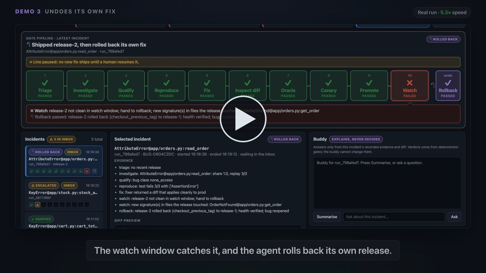

# Notin-Loop

**An autonomous SRE agent that watches a live server, investigates errors, fixes trivial bugs and ships them with no human approval — and rolls back or escalates whenever a check does not clearly pass.**

Built at the AI Hackathon with Nebius & NVIDIA.

## ▶ Watch the demo (64 seconds)

[](demo/notin-loop-demo.mp4)

**[▶ Play the demo video](demo/notin-loop-demo.mp4)** · [captions (SRT)](demo/notin-loop-demo.srt) · [narration script](demo/narration.md)

A real, recorded run of the dashboard, sped up and narrated, showing all three demos end to end:

1. **Fixed on its own:** a crash on `/cart/total` is investigated, reproduced, fixed, canaried and shipped with no human.
2. **Refused and escalated:** a flaky cache race fails replay, so the agent will not guess and sends it to a human.
3. **Undoes its own fix:** a fix passes tests and the canary, breaks a rare endpoint, and the agent rolls it back.

## For judges: three ways to check it

| Time | What | How |
| --- | --- | --- |
| 1 min | Watch the video | [demo/notin-loop-demo.mp4](demo/notin-loop-demo.mp4) |
| 2 min | Click through the real dashboard | **[notin-loop.vercel.app](https://notin-loop.vercel.app)**: a read-only recording of a full run (select each incident to see its evidence, diff and gates) |
| ~10 min | Run it yourself, no API key needed | [Quickstart](#quickstart) below: 201 tests, then all three demos live with one command |

---

## The Problem

Coding agents can already produce plausible fixes for bugs. The bottleneck is not capability — it is trust. Nobody wants to merge and deploy an AI-generated fix without a human reading it first. The human stays in the loop, the loop becomes the bottleneck, and the "autonomous" part quietly disappears.

## Our Approach: A Dark Factory

In manufacturing, a dark factory runs with the lights off because the interlocks and automatic line-stops make it safe — not because the robots are clever. We apply the same idea to code fixes.

The bug-fixing model is a black box we never look inside. **We build everything around it:** the evidence gate that qualifies the bug, the test that proves it, the inspection that reads the diff, the oracle that runs the tests, the canary that checks live traffic, the watch window that catches late failures, and the rollback that undoes mistakes. Trust lives in the system, not in any single model.

### The Single Rule

Every stage returns `pass`, `fail`, or `unsure`. Only an unbroken chain of `pass` changes the server. Anything else stops the line and escalates to a human with the evidence attached.

---

## Architecture

```text
  traffic ──► stable :8101 ◄──────── prod branch
     │   ──► canary :8102 ◄──────── patched worktree (stage 9 only)
     │          │
     │          ▼
     │   SRE agent (always on)
     │   ├─ watcher     → metrics, logs
     │   ├─ alert       → threshold breached
     │   ├─ triage      → did our own release cause this?
     │   ├─ investigate  → evidence gate
     │   ├─ qualify      → is this fixable without a human?
     │   ├─ reproduce    → LLM writes a test, code validates it
     │   ├─ fix          → black box returns a diff
     │   ├─ inspect diff → static rules before any patched code runs
     │   ├─ oracle       → repro test passes, full suite stays green
     │   ├─ canary       → 80/20 traffic split, SLO check
     │   ├─ promote      → commit to prod, tag, watch window
     │   └─ rollback     → previous tag or git revert, health verified
     │
     ├─ runs/audit.jsonl     (hash-chained, HMAC-signed)
     ├─ runs/releases.json   (release ledger with git tags)
     └─ runs/inbox/          (escalation cases with evidence)
```

### Pipeline Flow

```
Bug on server → [Detect] → [Triage] → [Investigate] → [Qualify] → [Reproduce]
    → [Fix] → [Inspect Diff] → [Oracle] → [Canary] → [Promote + Watch]
                                                              │
                                                    SLO slip or new errors
                                                              │
                                                         [Rollback]
                                                              │
                                              ┌───────────────┘
                                              ▼
                              Every non-pass → Escalate to human
```

### Where the Human Sits

The human is **out of the loop** for the action — no approval click to fix, deploy, or roll back. But they are **on the loop** for governance: a tamper-evident audit trail, replay of any decision, a kill switch, and manual rollback at any time.

---

## Key Features

### Evidence-Grounded Investigation

The agent does not guess. It groups errors by signature, replays failing requests against the live server, and maps stack traces to source files. At least two independent evidence sources must agree before the agent acts. Reuses the evidence gate from our [base SRE-agent](https://github.com/hannykumar/SRE-agent).

### Deterministic Gates

Every pass/fail decision is made by code, not a model. The LLM writes tests and diffs; deterministic rules decide whether they are good enough.

### Diff Inspection Before Execution

Before any patched code runs, static checks verify: the diff is small and localized, it touches no test or dependency files, it contains no secrets, and it adds no dangerous imports. A rogue fixer that edits the test, hardcodes an expected value, or adds a dependency is caught here.

### Canary Deployment with SLO Verification

The fix runs as a canary taking 20% of traffic. Error rate and latency are compared to stable using `classify_verification_outcome` (ported from the base SRE-agent). Only a canary that stays within SLO is promoted.

### Post-Release Watch Window

After promotion, the agent keeps watching. If the original bug signature returns, or a new error signature appears in a file the release touched, the agent rolls back automatically and verifies health is restored.

### Tamper-Evident Audit Trail

Every stage appends a hash-chained, HMAC-signed entry to `audit.jsonl`. Editing, deleting, or reordering any entry breaks the chain. `replay` re-runs the deterministic gates on stored artifacts and confirms the same decisions.

### Self-Rollback

The agent rolls back only its own releases. If a human release caused the problem, it escalates instead of guessing. After any rollback, health is verified and the line pauses until a person resets it.

---

## The Three Demos

| Demo                         | What happens                                                                                                                                                                                                  | What it proves                                                         |
| ---------------------------- | ------------------------------------------------------------------------------------------------------------------------------------------------------------------------------------------------------------- | ---------------------------------------------------------------------- |
| **1. Fixed on its own**      | `GET /cart/total` on an empty cart crashes the server with a `KeyError`. The agent detects, investigates, reproduces, fixes, canaries, and promotes — error rate drops to zero with nobody touching anything. | The full autonomous pipeline works end to end.                         |
| **2. Refused and escalated** | `GET /stock/{sku}/available` fails intermittently from a cache race. The agent's replay fails 1 of 3 times, so the evidence gate returns `unsure`. The case goes to a human before any fix is attempted.      | The agent knows what it doesn't know.                                  |
| **3. Undoes its own fix**    | A fix for a missing-order crash changes a shared helper. It passes all tests and the canary, but breaks the rarely called `/reports/daily`. The watch window catches the new error and rolls back.            | Trust extends past the test suite — the agent undoes its own mistakes. |

---

## Tech Stack

| Layer           | Choice                                   |
| --------------- | ---------------------------------------- |
| Language        | Python 3.11+                             |
| Server          | FastAPI, Uvicorn                         |
| Metrics         | prometheus-client                        |
| Tests           | pytest with JUnit XML                    |
| Code control    | git CLI (worktrees, tags, revert)        |
| LLM             | Nebius AI Studio                         |
| Audit integrity | hashlib, hmac (stdlib)                   |
| Terminal UI     | rich                                     |
| Report          | jinja2 → static HTML                     |
| Dashboard       | FastAPI + vanilla JS with SSE            |

---

## Project Structure

```text
Notin-Loop/
├── SRE-agent/                    # base source (reused, not rewritten)
│   ├── agent/approval.py         #   → canonical_hash, verify pattern
│   ├── agent/evidence_ledger.py  #   → evidence envelopes, evidence gate
│   ├── runtime/alert_sources.py  #   → alert normalisation
│   └── executor/engine.py        #   → classify_verification_outcome (ported)
│
└── factory_flow/                 # the dark factory
    ├── factory/                  # the agent
    │   ├── sre_base.py           # only bridge to the base source
    │   ├── contracts.py          # Verdict, BugReport, Release, Fixer protocol
    │   ├── policy.py             # all thresholds and rules in one file
    │   ├── pipeline.py           # stage runner, kill switch, audit
    │   ├── watcher.py            # metrics + log → alerts
    │   ├── audit.py              # hash-chained, HMAC-signed JSONL
    │   ├── replay.py             # verify chain + re-derive decisions
    │   ├── dashboard_api.py      # live dashboard with SSE + LLM buddy
    │   └── stages/               # one file per gate
    │       ├── triage.py         # own release? → rollback first
    │       ├── investigate.py    # evidence gate
    │       ├── qualify.py        # scope rules
    │       ├── reproduce.py      # LLM writes test, code validates
    │       ├── inspect_diff.py   # static diff rules
    │       ├── oracle.py         # test suite verification
    │       ├── canary.py         # 80/20 traffic split + SLO
    │       ├── promote.py        # commit, tag, watch window
    │       └── rollback.py       # revert + health verification
    │
    └── target_service/           # the server the agent watches
        ├── app/                  # FastAPI app with planted bugs
        ├── tests/                # 16 passing tests (none cover the bugs)
        ├── patches/              # known-good fixes for the scripted fixer
        └── traffic/              # request profiles for demos
```

---

## Built on SRE-agent

This project extends our [existing SRE-agent](https://github.com/hannykumar/SRE-agent) without rewriting it. The base agent already held the right philosophy — AI reasons while deterministic code controls, escalate when evidence is insufficient — but required a human to approve every action. This project asks what has to be true to remove that approval.

| What we reused                     | How                                                                                                       |
| ---------------------------------- | --------------------------------------------------------------------------------------------------------- |
| `canonical_hash()`                 | Imported directly for audit hashing and diff integrity                                                    |
| `evaluate_evidence_gate()`         | Imported directly for the investigation stage                                                             |
| `normalize_generic_alert()`        | Imported directly for alert intake                                                                        |
| `classify_verification_outcome()`  | Ported (it imports Kubernetes modules we don't need) for canary, watch window, and rollback health checks |
| Evidence envelope helpers          | Imported for building grounded investigation evidence                                                     |
| Approval and verification patterns | Followed for diff integrity and idempotent deploys                                                        |

---

## Threat Model

We name our limits openly because that is what earns trust.

| Threat                                       | Interlock                                                             |
| -------------------------------------------- | --------------------------------------------------------------------- |
| Wrong diagnosis from noisy errors            | Evidence gate: dominant signature, 3/3 replay, ≥2 independent sources |
| Fixer edits the test                         | Diff inspection: `tests/` is a protected path                         |
| Fixer hardcodes the expected value           | Diff inspection: literal from frozen test detected in source          |
| Fixer adds a dependency                      | Diff inspection: dependency files are protected                       |
| Fix passes tests but fails on live traffic   | Canary SLO check                                                      |
| Fix passes canary but breaks a rare endpoint | Post-release watch window catches new error signatures                |
| Agent's own release caused the alert         | Triage rolls back before investigating                                |
| Diff swapped between check and deploy        | Hash recomputed before canary and promote                             |
| Audit log tampered with                      | Hash chain + HMAC; replay detects the break                           |

**Known limits:**

- The agent fixes only what it can observe. Silent wrong-answer bugs need synthetic probes (next step).
- A wrong generated test can certify a wrong fix. The canary and watch window are the defences after the oracle.
- The fixer's runtime is not sandboxed. A container with no secrets and a network allowlist is the next step.
- The agent never reverts human releases, by design.

---

## Quickstart

Runs entirely on one laptop (macOS or Linux) with **Python 3.11 or 3.12** and git. **No API key is needed:** `--fixer scripted` applies the repo's known-good patches instead of calling the LLM, and every gate, canary, watch window and rollback still runs for real.

```bash
# 1. clone and install
git clone https://github.com/hannykumar/Notin-Loop.git
cd Notin-Loop
python3.12 -m venv .venv && source .venv/bin/activate
pip install -r factory_flow/requirements.txt
cp factory_flow/.env.example factory_flow/.env   # optional: add LLM_API_KEY / LLM_MODEL for the Nebius fixer

# 2. initialise the target service (its own git repo, tagged release-0)
cd factory_flow/target_service && bash scripts/init_repo.sh && cd ..

# 3. run the tests (185 agent tests + 16 target-service tests)
pytest -q tests && (cd target_service && pytest -q)
```

**Option A: all three demos, hands-free (about 3 minutes).** Resets to a clean state, plays demo 1 → 2 → 3 and prints a scoreboard that checks each outcome and the final server state.

```bash
python -m factory.cli run-all --fixer scripted
# ends with: [ok] demo1 ... [ok] demo2 ... [ok] demo3 ... bad changes left on the server: 0
```

**Option B: drive it from the dashboard.**

```bash
bash scripts/start.sh --fixer scripted --ui 8100     # stable server + traffic + agent + dashboard
# open http://localhost:8100 and press Break cart, Break stock or Break 404,
# or from another terminal (with the venv active, inside factory_flow/):
python -m factory.cli break cart     # demo 1: fixed autonomously
python -m factory.cli break stock    # demo 2: escalated
python -m factory.cli break 404      # demo 3: promoted, then rolled back
python -m factory.cli break normal   # back to healthy traffic
```

Press Ctrl-C to stop everything. `bash scripts/reset.sh` returns to a clean state (target service back at `release-0`, empty `runs/`).

**Inspect the results** (inside `factory_flow/`):

```bash
python -m factory.cli inbox                 # escalation cases waiting for a human
python -m factory.cli replay <run_id>       # verify the audit chain and re-derive that run's decision
python -m factory.cli report > report.html  # static HTML report of every run
```

The agent uses ports 8101 (stable) and 8102 (canary); the dashboard uses the port you pass to `--ui` (8099 if you pass none).

---

## Team

Built by [Hanny Kumar](https://github.com/hannykumar) and [Mayank Choudhary](https://github.com/mayankchoudhary) at the AI Hackathon with Nebius & NVIDIA.
