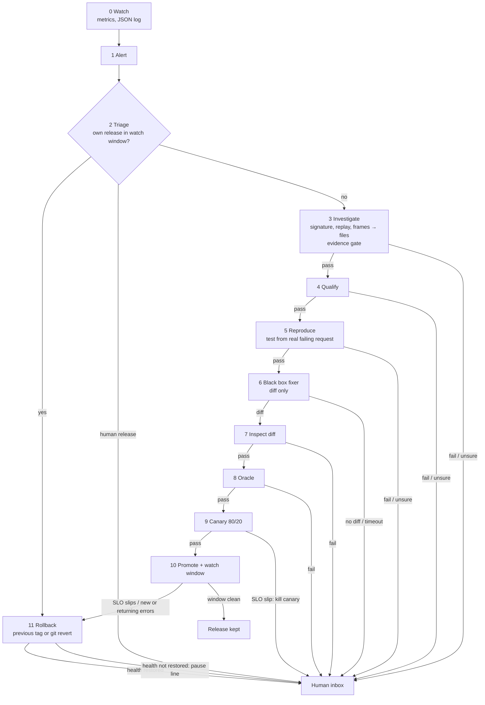
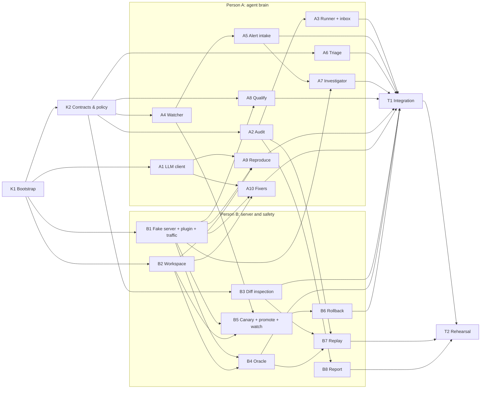

# PRD: Autonomous SRE Agent with a Dark-Factory Confidence Layer

> Final product requirements document. Written so that two people, or a coding agent, can build the project from this file alone.
> Base source: the SRE-agent repository (https://github.com/hannykumar/SRE-agent), already cloned in our repository, used as the base: extended and reused, never rewritten (small approved improvements allowed, §16.1).
> New work: a separate flow folder, `factory_flow/`, next to it.
> Building with Claude Code: every step in §9.2 has its own prompt; §16 has setup, CLAUDE.md and the session-start prompt.
> Event: AI Hackathon with Nebius & NVIDIA. Build window: 2–3 hours. Team: 2 people working in parallel.

---

## 1. One-liner

**An always-on SRE agent that watches a live server, investigates errors when an alert fires, fixes trivial bugs and ships them with no human approval, and rolls back or escalates whenever a check does not clearly pass.**

---

## 2. Overview

### 2.1 The problem

A coding agent can already produce a plausible fix for a bug. Nobody wants to deploy that fix without a human reading it first, so the human becomes the bottleneck and "autonomous" quietly disappears. This is a **trust problem, not a capability problem**.

### 2.2 The idea: a dark factory around an SRE agent

A dark factory runs with the lights off. It is safe not because the robots are clever, but because of the interlocks and automatic line-stops around them. The bug-fixing model is the robot arm: a black box we never look inside. **We build the interlocks**, and we put them inside an SRE agent that lives next to a running server.

### 2.3 How it works

The agent watches a running server. When errors cross a threshold, an alert fires. The agent first checks whether its own recent release caused the problem; if so, it rolls back. Otherwise it investigates: it groups the errors, replays a failing request, maps the stack trace to source files, and writes a bug report backed by evidence. It decides whether the bug is trivial enough to fix alone, turns the real failing request into a test, asks a black-box fixer for a diff, inspects the diff, and proves the fix with tests. The fix goes live as a canary, is promoted, and is watched for a while; if anything slips, it is rolled back. Anything uncertain at any step goes to a human with the evidence attached.

### 2.4 The single rule

Every stage returns `pass`, `fail` or `unsure`. **Only an unbroken chain of `pass` changes the server. Anything else stops the line and escalates to a human.** Rollback is the only action the agent may take on its own when something goes wrong, and only for its own releases.

### 2.5 Where the human sits

- **Out of the loop** for the action: no approval click to fix, deploy or roll back the agent's own releases.
- **On the loop** for governance: an escalation inbox, a tamper-evident audit trail, replay of any decision, a kill switch, and manual rollback at any time.

### 2.6 Difference from the base SRE-agent

| | Base SRE-agent | This project |
| --- | --- | --- |
| Trigger | Alert | Alert (same) |
| Investigation | Evidence-grounded, Kubernetes incident classes | Evidence-grounded, narrower: code bugs from logs, metrics and replayed requests |
| Action | Runtime remediation (restart, rollback, scale) | Code fix (diff), plus rollback of its own releases |
| Who approves | A human approves every action | Deterministic gates approve qualified fixes; the human handles escalations |

---

## 3. Goals, judging and scope

### 3.1 Judging criteria

| Weight | Criterion | How we score |
| --- | --- | --- |
| 50% | Technical background | Every brief requirement implemented (§12), deterministic gates, evidence gate reused from SRE-agent, release ledger and rollback, tamper-evident audit with replay, threat model with named limits |
| 30% | Presentability | Live `rich` terminal view of every stage; HTML report generated from the audit log |
| 20% | Presentation | Three live demos: the agent fixes, refuses, and undoes its own fix, with nobody touching anything |

### 3.2 Success criteria (definition of done)

- [ ] **Demo 1:** a crashing bug goes alert → investigation → fix → canary → promoted with zero human input; the error rate returns to baseline.
- [ ] **Demo 2:** an intermittent bug is escalated at the evidence gate before any fix is attempted.
- [ ] **Demo 3:** a promoted fix that breaks a rarely used endpoint is rolled back during the watch window, and health is verified after rollback.
- [ ] Unit tests prove the interlocks not shown live: rogue diffs rejected, a canary-breaking patch killed, own-release triage, rollback of an older release.
- [ ] `replay <run_id>` verifies the audit chain and re-derives the same decision; tampering is detected.
- [ ] The kill switch stops the line within one stage.
- [ ] Final scoreboard shows **bad changes left on the server: 0**.
- [ ] SRE-agent's own test suite still passes; any change to SRE-agent files was approved, minimal, and committed separately with the `base:` prefix.

### 3.3 Out of scope

- Any cloud server, VM, tunnel, Docker or gateway. Everything runs on one laptop; the server exists only to showcase the agent.
- A UI beyond the `rich` terminal view and the generated HTML report.
- Sandboxing the fixer's runtime (named as the next step, per the brief).
- Detecting silent wrong-answer bugs (needs synthetic probes; named as a limit).
- Rolling back releases made by humans (the agent escalates instead).
- Rewriting or restructuring the SRE-agent source (small approved improvements are allowed, §16.1).

---

## 4. Tech stack

| Layer | Choice | Why |
| --- | --- | --- |
| Language | Python 3.11 or 3.12 | Same as SRE-agent; its modules import directly |
| Fake server (target service) | FastAPI + Uvicorn | Same stack as SRE-agent's `lab/demo_service.py`; `TestClient` lets reproduce tests run without a network |
| Server signals ("plugin") | FastAPI middleware + `prometheus-client` | One JSON log line per request (traceback on 5xx) and `/metrics` counters by path and status |
| HTTP client | `httpx` | Traffic generator, watcher scraping, request replay; already required by FastAPI's `TestClient` |
| Tests and oracle | `pytest` with `--junitxml` | Machine-readable results with no extra plugins |
| Code control | `git` CLI via `subprocess` | Worktrees for isolated copies, `apply --check`, tags for releases, `revert` for rollback |
| LLM | `openai` Python SDK pointed at Nebius AI Studio's OpenAI-compatible endpoint | Writes reproduction tests and (optionally) fixes; model chosen via `LLM_MODEL` |
| Base logic reused | SRE-agent: `agent/approval.py`, `agent/evidence_ledger.py`, `runtime/alert_sources.py`, plus one ported function from `executor/engine.py` | Hashing, evidence envelopes and gate, alert normalisation, verification outcomes (§5) |
| Audit and integrity | Python stdlib `hashlib`, `hmac`, `json` | Hash-chained, HMAC-signed JSONL; no database |
| Terminal view | `rich` | Live per-stage status for the demo |
| HTML report | `jinja2` | Report rendered from the audit log |
| Process control | stdlib `subprocess`, `threading`, `signal` | Start, stop and restart stable and canary instances |
| Storage | Files: JSONL and JSON under `factory_flow/runs/` | Inspectable, replayable, zero setup |
| Runtime | One laptop, `localhost` only | Free, no network setup; only the LLM call needs internet |

`factory_flow/requirements.txt`:

```text
fastapi
uvicorn
prometheus-client
httpx
pytest
openai
rich
jinja2
```

Pin versions at kickoff to whatever installs cleanly; FastAPI, Uvicorn, pytest and prometheus-client can match SRE-agent's `requirements.txt`.

---

## 5. Repository setup: SRE-agent as the base source

### 5.1 Folder layout

```text
<our-repo>/
├── SRE-agent/                    # cloned base source. Reused, not rewritten (§16.1).
│   ├── agent/approval.py         #   imported
│   ├── agent/evidence_ledger.py  #   imported
│   ├── runtime/alert_sources.py  #   imported
│   └── executor/engine.py        #   one function ported (not imported)
└── factory_flow/                 # NEW flow folder: everything we build
    ├── README.md
    ├── requirements.txt
    ├── .env.example
    ├── scripts/
    │   ├── start.sh              # starts fake server + agent + traffic generator
    │   └── reset.sh              # back to release-0, clears runs/
    ├── factory/                  # the agent
    │   ├── __init__.py
    │   ├── sre_base.py           # the only bridge to SRE-agent (§5.2)
    │   ├── contracts.py
    │   ├── policy.py
    │   ├── watcher.py
    │   ├── alerts.py
    │   ├── releases.py
    │   ├── pipeline.py
    │   ├── inbox.py
    │   ├── workspace.py
    │   ├── llm.py
    │   ├── fixers.py
    │   ├── audit.py
    │   ├── replay.py
    │   ├── report.py
    │   ├── cli.py
    │   ├── templates/report.html
    │   └── stages/
    │       ├── triage.py
    │       ├── investigate.py
    │       ├── qualify.py
    │       ├── reproduce.py
    │       ├── inspect_diff.py
    │       ├── oracle.py
    │       ├── canary.py
    │       ├── promote.py
    │       └── rollback.py
    ├── target_service/           # the fake server; its own git repo (main, prod, release-N tags)
    │   ├── app/
    │   │   ├── main.py           # FastAPI app; installs the plugin middleware
    │   │   ├── sre_plugin.py     # JSON request log + /metrics
    │   │   ├── cart.py           # demo 1 bug
    │   │   ├── orders.py         # demo 3 bug + shared get_order() helper
    │   │   ├── reports.py        # rare endpoint that also uses get_order()
    │   │   └── stock.py          # demo 2 intermittent bug
    │   ├── tests/                # ~15 tests; green; do not cover the bugs or /reports/daily
    │   ├── patches/              # cart_fix.diff, orders_helper_fix.diff
    │   ├── fallback_tests/       # hand-written repro tests, used only if the LLM is unavailable
    │   └── traffic/              # normal.json, break_cart.json, break_stock.json, break_404.json
    ├── tests/                    # unit tests for the agent
    │   └── fixtures/             # rogue and canary-breaking diffs
    ├── scenarios.json            # expected outcomes for the scoreboard; never read by the pipeline
    └── runs/                     # generated: audit.jsonl, releases.json, inbox/, server.log, artifacts/, report.html
```

### 5.2 How `factory_flow` uses SRE-agent

All access goes through one module, `factory/sre_base.py`:

1. It reads `SRE_AGENT_PATH` from `.env` (default `../SRE-agent`), checks the folder exists, and inserts it at the front of `sys.path`.
2. It imports and re-exports the stdlib-only functions below. These three modules import nothing outside the Python standard library, so no SRE-agent dependencies need to be installed.
3. It contains a ported copy of `classify_verification_outcome` with a comment naming its source file and commit. It is ported because `executor/engine.py` imports Kubernetes, GitOps and settings modules we do not use.
4. It records the SRE-agent commit hash (`git -C $SRE_AGENT_PATH rev-parse HEAD`) in every run's first audit entry, so results are tied to a known base version.

No other file in `factory_flow` imports from SRE-agent directly.

| SRE-agent source | How | Used for |
| --- | --- | --- |
| `runtime/alert_sources.py` → `normalize_generic_alert()` | import | Normalise every alert the watcher raises; a Grafana webhook could replace the watcher later with no other change |
| `agent/evidence_ledger.py` → `alert_evidence()`, `tool_evidence()`, `evaluate_evidence_gate()` | import | Evidence envelopes and the investigation gate (§7.4) |
| `agent/approval.py` → `canonical_hash()` | import | Audit entry hashes, diff and test hashes |
| `executor/engine.py` → `classify_verification_outcome()` | port | Canary vs stable, watch window vs baseline, health after rollback |
| `agent/approval.py` → `verify_proposal_artifact()` | pattern | "Refuse if what you run differs from what was checked" (§7.6) |
| `executor/service.py` → `_claim()` | pattern | Promote and rollback keyed by hash; never run the same operation twice |
| `executor/engine.py` → `execute_rollback()` | pattern | Rollback as an audited operation with its own verification |
| `/runs/{run_id}/approve-execute` | concept | Becomes the escalation inbox (`factory/inbox.py`); in production, escalations become runs in the existing workbench |
| `lab/demo_service.py` | template | Fake server structure and metrics counters |
| `lab/fixtures/incidents/incident_ambiguous.json` | concept | Demo 2, the case the agent must refuse |
| `config/catalog/incident_catalog.json` | model | `policy.py` bug classes; anything else escalates |
| `evaluation/` harness | pattern | `run-all` and the scoreboard |

### 5.3 The story to tell

> "Our SRE agent already investigated alerts with evidence, but a human approved every action. This project asks what has to be true to remove that approval. We kept its alert intake, evidence gate and verification logic as our base, and built a new flow around it: a code-fix pipeline with deterministic interlocks, where the approval step becomes an escalation inbox for the cases the agent refuses."

---

## 6. End-to-end workflow

| # | Stage | What happens | Pass condition | On fail / unsure |
| --- | --- | --- | --- | --- |
| 0 | Watch | Scrapes error rate and p95 per path from `/metrics`; tails the JSON log | — | — |
| 1 | Alert | Threshold breached for N windows; payload built and normalised | Alert well formed, not a duplicate | Ignored |
| 2 | Triage | Did one of our releases start inside its watch window? | No own recent release | Own release → stage 11, then escalate; human release → escalate |
| 3 | Investigate | Group errors by signature, replay a sample request 3×, map frames to files, write the bug report | Evidence gate passes | Escalate |
| 4 | Qualify | Allowed bug class, ≤2 files, no protected paths, deny keywords, suite green on `prod` | All checks pass | Escalate |
| 5 | Reproduce | LLM turns the real failing request into a test | Fails 3/3 for the right reason; frozen | Escalate |
| 6 | Fix | Black box gets a throwaway copy + test, returns a diff | Valid diff within time limit | Escalate |
| 7 | Inspect diff | Static rules on the diff, before any of it runs | All rules pass | Escalate |
| 8 | Oracle | Fresh copy + diff; repro test, then full suite | Repro green, no regressions | Escalate |
| 9 | Canary | Patched instance takes 20% of generated traffic | Diff hash matches; SLO holds vs stable | Kill canary, escalate |
| 10 | Promote & watch | Commit to `prod`, tag release, restart stable, watch window | SLO holds, bug signature absent, no new signatures in touched files | Stage 11 |
| 11 | Rollback | Previous tag, or `git revert` only this release's commit | Health back to pre-release level | Pause line, escalate as critical |
| — | Inbox | Every stop lands here with its evidence | — | — |
| — | Audit | Every stage appends a hash-chained, HMAC-signed entry | — | — |

---

## 7. Architecture

### 7.1 Pipeline



Every stage also writes one audit entry, and the runner checks the kill switch before every stage.

### 7.2 What runs on the laptop

```text
 traffic generator ──(80%)──► stable  :8101  worktree of `prod`      ┐
        │          ──(20%)──► canary  :8102  patched worktree        │ both write runs/server.log
        │                     (only during stage 9)                  │ and expose /metrics
        │                                                            │
        └── `break <demo>` switches its request mix                  ▼
                                                   SRE agent (factory/cli.py)
                                                   watcher → runner → stages
                                                   ├─ runs/audit.jsonl
                                                   ├─ runs/releases.json
                                                   ├─ runs/inbox/
                                                   └─ LLM on Nebius (only network call)
```

The agent never edits the running server's files. It changes the server only by switching which git commit the stable or canary process runs.

### 7.3 Components

| Component | File | Deterministic? | Responsibility |
| --- | --- | --- | --- |
| SRE bridge | `factory/sre_base.py` | yes | Only access point to SRE-agent (§5.2) |
| Contracts | `factory/contracts.py` | yes | `Alert`, `BugReport`, `Verdict`, `Release`, `RunState`, `Fixer` |
| Policy | `factory/policy.py` | yes | Thresholds, windows, bug classes, deny keywords, protected paths, limits, SLOs, safe-to-replay paths |
| Watcher | `factory/watcher.py` | yes | Scrape metrics, tail log, raise alerts; `baseline()` and `current()` |
| Alert intake | `factory/alerts.py` | yes | Build payload, normalise, dedupe |
| Release ledger | `factory/releases.py` | yes | Record releases, find own release in window, previous tag |
| Triage | `factory/stages/triage.py` | yes | Route: rollback, escalate, or investigate |
| Investigator | `factory/stages/investigate.py` | yes | Signatures, replay, frame mapping, evidence gate, bug report |
| Qualify | `factory/stages/qualify.py` | yes | Scope rules |
| Reproduce | `factory/stages/reproduce.py` | LLM writes, code decides | Test from failing request; validate; freeze |
| Fixers | `factory/fixers.py` | black box | `LLMFixer`, `ScriptedFixer`, `FixtureFixer`; diff only |
| Diff inspection | `factory/stages/inspect_diff.py` | yes | Static rules on the diff |
| Oracle | `factory/stages/oracle.py` | yes | Repro test and full suite on a fresh copy |
| Canary | `factory/stages/canary.py` | yes | Start canary, split traffic, judge SLO |
| Promote | `factory/stages/promote.py` | yes | Hash check, commit, tag, restart, watch window |
| Rollback | `factory/stages/rollback.py` | yes | Previous tag or revert, restart, verify health |
| Runner | `factory/pipeline.py` | yes | Sequence stages, kill switch, audit, escalate |
| Inbox | `factory/inbox.py` | yes | Escalation cases with evidence |
| Workspace | `factory/workspace.py` | yes | Worktrees, apply diff, pytest, start/stop instances |
| LLM client | `factory/llm.py` | — | OpenAI SDK → Nebius |
| Audit | `factory/audit.py` | yes | Append-only JSONL, hash chain, HMAC, verify |
| Replay | `factory/replay.py` | yes | Verify chain, re-run deterministic gates, compare |
| Report | `factory/report.py` | yes | `rich` live view + HTML report |
| CLI | `factory/cli.py` | — | `start`, `break <demo>`, `inbox`, `rollback <release>`, `replay <run>`, `pause`, `resume`, `report`, `run-all` |

### 7.4 Core contracts

These are agreed at kickoff and frozen; both people code against them.

```python
# factory/contracts.py
Status = Literal["pass", "fail", "unsure"]

@dataclass(frozen=True)
class Verdict:
    stage: str
    status: Status
    reasons: list[str]
    checks: dict[str, bool]       # all True => "pass"
    evidence: dict[str, Any]      # artifact paths + SHA-256 hashes

@dataclass(frozen=True)
class BugReport:                  # written by the investigator
    id: str
    alert_id: str
    signature: str                # "KeyError@app/cart.py:cart_total"
    exception_type: str
    traceback: str
    sample_request: dict          # method, path, query, body
    files: list[str]
    error_share: float
    replay_failures: int          # out of 3
    evidence_ids: list[str]

@dataclass(frozen=True)
class Release:
    tag: str                      # "release-2"
    commit: str
    previous_tag: str
    diff_sha256: str
    run_id: str
    promoted_at: str
    watch_until: str
    status: Literal["watching", "kept", "rolled_back"]

class Fixer(Protocol):
    name: str
    def fix(self, workspace: Path, bug: BugReport, failing_test: Path, timeout_s: int) -> str:
        """Return a unified diff. Nothing else from the fixer is read."""

# every stage:  def run(state: RunState) -> Verdict
```

Shared interfaces also frozen at kickoff: `audit.append(event: dict) -> dict`, `watcher.baseline(path) / current(path) -> dict` (keys `error_rate_percent`, `p95_latency_ms`, matching what `classify_verification_outcome` reads), `workspace.fresh_worktree(ref) -> Path`, `workspace.run_pytest(path, selector) -> dict`, and the `releases.json` format.

### 7.5 Investigation and the evidence gate

| Evidence | Source type | Example |
| --- | --- | --- |
| Alert | alert | 5xx rate 18% on `/cart/total` for 30 s |
| Log signature | logs | 41 of 44 errors are `KeyError` in `app/cart.py:cart_total` |
| Metric spike | metrics | `/cart/total` 5xx rose from 0% to 18% |
| Live replay | replay | sample request replayed 3× against stable: 3 of 3 return 500, same signature |
| Release history | releases | last agent release outside its watch window |

Gate checks (all must pass): dominant signature share ≥ 0.7; replay fails 3/3 with the same signature; at least 2 independent source types; frames resolve to files under `app/`; no critical contradictions. Only paths listed as safe in `policy.py` (idempotent `GET`s) are replayed.

### 7.6 Releases, rollback and diff integrity

- Every promotion appends a `Release` to `runs/releases.json` and tags `release-N` on `prod` in `target_service`.
- **Triage:** an alert while an agent release is `watching`, or within `ROLLBACK_LOOKBACK_S` of promotion, rolls that release back first.
- **Rollback method:** latest release → check out `previous_tag`; older release → `git revert` only its commit; conflict → no change, critical escalation.
- **Rollback verification:** error rate and p95 within SLO of the pre-release baseline, and the release's new error signatures gone, judged with `classify_verification_outcome`; otherwise pause and critical escalation.
- **After rollback:** release `rolled_back`, bug reopened in the inbox, `runs/PAUSED` created.
- **Manual:** `cli rollback release-N` uses the same path, audited with `actor: human`.
- **Diff integrity:** the oracle records `diff_sha256`; canary and promote recompute it and refuse on mismatch; promote refuses a hash already released.

### 7.7 Audit entry

```json
{
  "seq": 42,
  "run_id": "run_7f3a",
  "stage": "oracle",
  "actor": "agent",
  "status": "pass",
  "reasons": [],
  "checks": {"repro_now_passes": true, "suite_still_green": true},
  "evidence": {"diff_sha256": "…", "test_sha256": "…", "junit_sha256": "…"},
  "ts": "2026-10-18T14:03:11Z",
  "prev_hash": "<entry_hash of seq 41>",
  "entry_hash": "<canonical_hash of this entry without entry_hash/hmac>",
  "hmac": "<HMAC-SHA256(AUDIT_HMAC_KEY, entry_hash)>"
}
```

The first entry of every run also records the SRE-agent commit and the policy file hash.

---

## 8. The fake server and the three demos

### 8.1 Why a fake server, not just JSON files

The agent's key steps are measurements: replaying a failing request, comparing canary to stable, seeing new errors after a release, confirming health after rollback. A running server is what makes those measurements real. JSON is still used for alerts, bug reports, audit entries and unit-test fixtures.

### 8.2 The plugin

`target_service/app/sre_plugin.py` is FastAPI middleware installed in `main.py` with two lines. It:
- writes one JSON line per request to `runs/server.log`: `ts`, `instance` (`stable` or `canary`), `method`, `path`, `query`, `status`, `latency_ms`, and on 5xx the `exception_type` and full `traceback`;
- exposes `/metrics` with request counts by path and status and a latency histogram (`prometheus-client`).

This is the only thing a real service would need to add to be watched by the agent.

### 8.3 The three demos

| Demo | What breaks | Fixer | Expected outcome | What it proves |
| --- | --- | --- | --- | --- |
| 1 Fixed on its own (BUG-CART) | `GET /cart/total` on an empty cart raises `KeyError` → 500 | `LLMFixer` (`ScriptedFixer` with `cart_fix.diff` as fallback) | promoted, kept | The full chain: detect, investigate, reproduce, fix, verify, canary, promote, watch |
| 2 Refused and escalated (BUG-STOCK) | `GET /stock/{sku}/available` fails ~30% of the time from a race in a cache refresh | never called | escalated at stage 3 | Escalate by default: replay fails 1/3 or 2/3, so the evidence gate returns `unsure` |
| 3 Undoes its own fix (BUG-404) | `GET /orders/{id}` for a missing order raises `AttributeError` → 500 | `ScriptedFixer` with `orders_helper_fix.diff` | promoted, then rolled back | The fix changes the shared `get_order()` to return `None`; `/orders/{id}` is fixed but the rarely called `/reports/daily` now fails. Tests and the short canary never hit it; the watch window sees a new signature in a touched file and rolls back |

`normal.json` calls `/reports/daily` about every 20 s; the canary window is shorter than that interval, the watch window longer. After demo 3's rollback the original 404 bug is back, so the inbox case carries both the bug and the failed fix.

Interlocks not shown live are unit-tested with diffs in `tests/fixtures/`: edits the repro test, hardcodes the expected value, adds a dependency, breaks an endpoint under canary traffic; plus own-release triage and reverting an older release while keeping a newer one.

---

## 9. Plan of action: two people in parallel

### 9.1 Tracks

| Track | Owner | Focus | Files owned |
| --- | --- | --- | --- |
| **K** Kickoff | both | Setup and frozen interfaces | `sre_base.py`, `contracts.py`, `policy.py`, `requirements.txt`, `.env.example` |
| **A** Agent brain | Person A | Detect, investigate, decide, fix; runner and audit | `llm.py`, `audit.py`, `pipeline.py`, `inbox.py`, `watcher.py`, `alerts.py`, `stages/triage.py`, `stages/investigate.py`, `stages/qualify.py`, `stages/reproduce.py`, `fixers.py` |
| **B** Server and safety | Person B | Fake server, verify, execute, rollback, proof | `target_service/**`, `workspace.py`, `releases.py`, `stages/inspect_diff.py`, `stages/oracle.py`, `stages/canary.py`, `stages/promote.py`, `stages/rollback.py`, `replay.py`, `report.py`, `tests/fixtures/**` |
| **T** Together | both | Integration and rehearsal | `cli.py`, `scripts/*`, `scenarios.json` |

Each file has one owner, so both people commit to the same branch without conflicts. Changes to frozen contract files are announced and made by one person only.

### 9.2 Steps

Each step lists **depends on**, **build**, **validation** and a **Claude Code prompt** to paste for that step. A step is done only when its validation passes. Every prompt assumes `CLAUDE.md` (§16.2) is loaded and the session was started with the session prompt (§16.3).

#### Kickoff (both, first)

**K1 — Bootstrap**
- Depends on: nothing
- Build: create `factory_flow/` per §5.1; virtualenv; `requirements.txt`; `.env.example` with `SRE_AGENT_PATH`, `LLM_BASE_URL`, `LLM_API_KEY`, `LLM_MODEL`, `AUDIT_HMAC_KEY`; `sre_base.py` with path setup, re-exports, and the ported `classify_verification_outcome`.
- Validation: `python -c "from factory.sre_base import canonical_hash, evaluate_evidence_gate, normalize_generic_alert, classify_verification_outcome"`; SRE-agent's own test suite still passes (`PYTHONPATH=. pytest -q` inside SRE-agent).
- Claude Code prompt:

```text
Step K1, Bootstrap. Follow CLAUDE.md and PRD §9.2 K1.
Read first: PRD §4 and §5; in SRE-agent: README.md, PROJECT_STRUCTURE.md, requirements.txt, agent/approval.py, agent/evidence_ledger.py, runtime/alert_sources.py, and classify_verification_outcome in executor/engine.py.
Tasks:
- Confirm the layout: is SRE-agent a sibling of factory_flow/, or is the repo root the SRE-agent code? Tell me which, and set SRE_AGENT_PATH accordingly. Record the SRE-agent commit hash.
- Create the factory_flow/ skeleton from PRD §5.1 (empty modules with one-line docstrings are fine).
- requirements.txt: pin fastapi, uvicorn, pytest and prometheus-client to SRE-agent's versions; pick installable versions for httpx, openai, rich, jinja2.
- .env.example and .gitignore (runs/, .env).
- factory/sre_base.py: add SRE_AGENT_PATH to sys.path; re-export canonical_hash, alert_evidence, tool_evidence, evaluate_evidence_gate, normalize_generic_alert; port classify_verification_outcome with an attribution comment; add sre_agent_commit().
Do not change any SRE-agent file.
Plan first and wait for my approval. Then build it, run the validation and show the output, commit as "step K1: <summary>", and give me a step report (built; imported / ported / patterned from SRE-agent with paths; validation output; deviations).
```

**K2 — Contracts and policy (then frozen)**
- Depends on: K1
- Build: `contracts.py` and shared interfaces (§7.4); `policy.py`: alert threshold and windows, `WATCH_WINDOW_S`, `ROLLBACK_LOOKBACK_S`, gate thresholds, bug classes, deny keywords (`race|concurren|intermittent|migration|auth|payment`), protected paths (`tests/|requirements|pyproject|setup.|Dockerfile|.github/|patches/|traffic/|fallback_tests/`), `MAX_FILES=2`, `MAX_LINES=20`, canary SLOs, safe-to-replay paths.
- Validation: both modules import; both people agree and stop editing them.
- Claude Code prompt:

```text
Step K2, Contracts and policy. Follow CLAUDE.md and PRD §9.2 K2.
Read first: PRD §6, §7.4 to §7.6; in SRE-agent: evaluate_evidence_gate in agent/evidence_ledger.py (input shapes), classify_verification_outcome (metric keys it reads), config/catalog/incident_catalog.json (rule format), evaluate_condition / evaluate_rule in agent/evidence_graph.py.
Tasks:
- factory/contracts.py: the dataclasses, Fixer protocol and stage signature from PRD §7.4, plus typed signatures (docstring stubs) for the shared interfaces: audit.append, watcher.baseline/current, workspace.fresh_worktree/run_pytest, and the releases.json record.
- factory/policy.py: every value listed in PRD K2. Express bug classes as confirmation rules in the same condition format as the incident catalog, so the evaluate_condition logic can be ported later.
- List every place where the PRD's assumed shapes differ from the real SRE-agent code, and use the real shapes.
After this commit, contracts.py, policy.py and sre_base.py are frozen.
Plan first and wait for my approval. Then build it, run the validation and show the output, commit as "step K2: <summary>", and give me a step report (built; imported / ported / patterned from SRE-agent with paths; validation output; deviations).
```

#### Track A — Agent brain (Person A)

**A1 — LLM client**
- Depends on: K1
- Build: `complete(system, user) -> str` with the `openai` SDK, `base_url=LLM_BASE_URL`; timeout, one retry, strip code fences; `LLM_OFFLINE=1` makes it raise immediately so callers use fallbacks.
- Validation: one live call returns text.
- Claude Code prompt:

```text
Step A1, LLM client (Track A). Follow CLAUDE.md and PRD §9.2 A1.
Read first: agent/model_runtime.py in SRE-agent (OpenAI-compatible probing, success/failure recording) and agent/planner.py (structured model output with deterministic fallback).
Tasks:
- factory/llm.py: complete(system, user) -> str using the openai SDK with base_url=LLM_BASE_URL, LLM_API_KEY, LLM_MODEL from .env; timeout, one retry, strip markdown fences.
- Follow model_runtime.py's pattern of recording the last success or failure so stages can report which backend ran. Do not import it (it pulls runtime.settings).
- LLM_OFFLINE=1 makes complete() raise a clear LLMUnavailable error immediately, so callers can use fallbacks.
- One unit test with the client mocked, and one manual live call.
Plan first and wait for my approval. Then build it, run the validation and show the output, commit as "step A1: <summary>", and give me a step report (built; imported / ported / patterned from SRE-agent with paths; validation output; deviations).
```

**A2 — Audit log**
- Depends on: K2
- Build: `append()` with `prev_hash`, `entry_hash` via `canonical_hash`, HMAC; `verify() -> (ok, first_bad_seq)`.
- Validation: 5 entries verify; editing line 3 reports seq 3.
- Claude Code prompt:

```text
Step A2, Audit log (Track A). Follow CLAUDE.md and PRD §9.2 A2.
Read first: PRD §7.7; in SRE-agent: canonical_hash in agent/approval.py and log_audit_event / list_audit_events in runtime/storage.py (field naming: event type, actor, payload).
Tasks:
- factory/audit.py: append(event) adds seq, ts, prev_hash, entry_hash (canonical_hash via sre_base) and an HMAC with AUDIT_HMAC_KEY, written to runs/audit.jsonl in append mode; verify() -> (ok, first_bad_seq); read(run_id).
- Keep the actor field from SRE-agent's audit model ("agent" or "human").
- tests/test_audit.py: 5 entries verify; editing line 3 reports seq 3; a wrong HMAC key fails.
Plan first and wait for my approval. Then build it, run the validation and show the output, commit as "step A2: <summary>", and give me a step report (built; imported / ported / patterned from SRE-agent with paths; validation output; deviations).
```

**A3 — Runner, kill switch, inbox**
- Depends on: K2, A2
- Build: `pipeline.py` runs stages from an alert, checks `runs/PAUSED` before each stage, audits every verdict, stops on non-`pass`, writes an inbox case; first audit entry records SRE-agent commit and policy hash. Stub stages return `pass`.
- Validation: a fake alert produces a full stub run; `PAUSED` stops the next run; a forced `unsure` creates an inbox case.
- Claude Code prompt:

```text
Step A3, Runner, kill switch and inbox (Track A). Follow CLAUDE.md and PRD §9.2 A3.
Read first: PRD §2.4, §6, §7.3; in SRE-agent: runtime/job_runner.py (how a run executes a stored plan without replanning) and the approve-execute flow in runtime/api.py (the human step we are turning into an inbox).
Tasks:
- factory/pipeline.py: run(alert) executes the stage list from PRD §6 in order; checks runs/PAUSED before each stage; audits every Verdict; on any non-pass stops and calls the inbox. The first audit entry of a run records sre_agent_commit() and the hash of policy.py. Stages are stubs returning pass for now, each marked "# STUB: replaced in step <ID>".
- factory/inbox.py: write one JSON case per escalation (alert, bug report if any, all verdicts, evidence paths) to runs/inbox/; list() for the CLI.
- Tests: full stub run; PAUSED stops the next run; a forced unsure creates an inbox case.
Plan first and wait for my approval. Then build it, run the validation and show the output, commit as "step A3: <summary>", and give me a step report (built; imported / ported / patterned from SRE-agent with paths; validation output; deviations).
```

**A4 — Watcher**
- Depends on: K2. Real data from B1; until then, develop against a sample `server.log` and a recorded `/metrics` text.
- Build: every 2 s scrape `/metrics` of stable (and canary when up), per-path 5xx rate and p95 over a sliding window, tail `server.log`; alert after N consecutive breached windows; `baseline()` and `current()`.
- Validation: with B1 running, normal traffic raises nothing for 60 s; each `break_*` raises within ~10 s.
- Claude Code prompt:

```text
Step A4, Watcher (Track A). Follow CLAUDE.md and PRD §9.2 A4.
Read first: PRD §7.2 and §8.2; in SRE-agent: lab/demo_service.py (metric names and labels) and integrations/live_backends.py (how it reads Prometheus and logs).
Tasks:
- factory/watcher.py: every 2 s scrape /metrics from stable (and canary when running), compute per-path 5xx rate and p95 over a sliding window, tail runs/server.log; raise an alert after N consecutive breached windows (values from policy.py).
- baseline(path) and current(path) return dicts using the keys classify_verification_outcome reads (error_rate_percent, p95_latency_ms).
- Keep stable and canary separate using the log's instance field.
- If B1 is not committed yet, develop against tests/fixtures/sample_server.log and tests/fixtures/sample_metrics.txt, then switch to the live server and run the real validation.
Plan first and wait for my approval. Then build it, run the validation and show the output, commit as "step A4: <summary>", and give me a step report (built; imported / ported / patterned from SRE-agent with paths; validation output; deviations).
```

**A5 — Alert intake**
- Depends on: A4
- Build: generic payload (`alertname`, `service`, `severity`, `starts_at`, `labels.path`, `summary`) → `normalize_generic_alert`; dedupe by fingerprint while a run is active.
- Validation: one break produces one run.
- Claude Code prompt:

```text
Step A5, Alert intake (Track A). Follow CLAUDE.md and PRD §9.2 A5.
Read first: normalize_generic_alert and _generated_incident_id in runtime/alert_sources.py, and how runtime/api.py handles /alerts/events and deduplication.
Tasks:
- factory/alerts.py: build a generic payload (alertname, service, severity, starts_at, labels.path, summary) from a watcher breach; normalise it with normalize_generic_alert via sre_base; dedupe by fingerprint while a run for the same signature is active; hand the alert to pipeline.run.
- Test: a sustained break produces exactly one run.
Plan first and wait for my approval. Then build it, run the validation and show the output, commit as "step A5: <summary>", and give me a step report (built; imported / ported / patterned from SRE-agent with paths; validation output; deviations).
```

**A6 — Triage**
- Depends on: K2 (uses the `releases.json` format; B5 writes it)
- Build: own release `watching` or within lookback → rollback route; latest `prod` commit not in the ledger within lookback → escalate; else `pass`.
- Validation: unit tests for all three routes with fabricated ledgers.
- Claude Code prompt:

```text
Step A6, Triage (Track A). Follow CLAUDE.md and PRD §9.2 A6.
Read first: PRD §7.6 and the releases.json record in contracts.py.
Tasks:
- factory/stages/triage.py: if an agent release is in "watching" state or was promoted within ROLLBACK_LOOKBACK_S of the alert, return a verdict routing to rollback; if the latest prod commit is not in the ledger and is within the lookback (a human release), return unsure with reason "human release, not reverted"; otherwise pass.
- Read the ledger file directly by its contract format; B5 writes it. Use fabricated ledgers in tests.
- Tests for all three routes.
Plan first and wait for my approval. Then build it, run the validation and show the output, commit as "step A6: <summary>", and give me a step report (built; imported / ported / patterned from SRE-agent with paths; validation output; deviations).
```

**A7 — Investigator**
- Depends on: A5, B1
- Build: §7.5: group 5xx by signature, dominant share, sample request, 3× replay if safe, frame → file mapping, envelopes via `alert_evidence` / `tool_evidence`, adapter to gate nodes, `evaluate_evidence_gate`, `BugReport`.
- Validation: BUG-CART and BUG-404 give correct reports; BUG-STOCK returns `unsure`.
- Claude Code prompt:

```text
Step A7, Investigator (Track A). Follow CLAUDE.md and PRD §9.2 A7.
Read first: PRD §7.5; in SRE-agent: agent/evidence_ledger.py in full, build_evidence_graph and _graph_source_metadata in agent/evidence_graph.py (how source_type and source_name are assigned), and lab/fixtures/incidents/incident_ambiguous.json.
Tasks:
- factory/stages/investigate.py: read the log lines in the alert window; group 5xx by signature (exception type + deepest frame under app/); compute the dominant share; pick a sample request; replay it 3 times against stable only if its path is in policy's safe list; map frames to files.
- Build evidence with alert_evidence / tool_evidence, then a small adapter that turns them into graph nodes with evidence_id, source_type and source_name, following evidence_graph.py's conventions. Build one candidate (score = dominant share, citations, contradicting_signals) and gate with evaluate_evidence_gate plus the extra checks in PRD §7.5.
- Return a BugReport in the verdict evidence.
- Validate live against B1: BUG-CART and BUG-404 give correct reports; BUG-STOCK returns unsure.
Plan first and wait for my approval. Then build it, run the validation and show the output, commit as "step A7: <summary>", and give me a step report (built; imported / ported / patterned from SRE-agent with paths; validation output; deviations).
```

**A8 — Qualify**
- Depends on: K2, B1
- Build: deny keywords; files ≤ `MAX_FILES`, none protected; suite green on `prod` (twice, flaky recorded); bug class by exception type.
- Validation: BUG-CART and BUG-404 pass; a report pointing at `requirements.txt` fails.
- Claude Code prompt:

```text
Step A8, Qualify (Track A). Follow CLAUDE.md and PRD §9.2 A8.
Read first: config/catalog/incident_catalog.json and evaluate_condition / evaluate_rule in agent/evidence_graph.py.
Tasks:
- Port evaluate_condition and evaluate_rule into factory/stages/qualify.py with an attribution comment (do not import evidence_graph.py; it loads the incident catalog).
- Checks: deny keywords over signature, traceback and path; files <= MAX_FILES and none protected; target_service suite green on prod (run twice, record flaky tests); bug class matched by policy's confirmation rules, otherwise unsure.
- Tests: BUG-CART and BUG-404 pass; a report pointing at requirements.txt fails.
Plan first and wait for my approval. Then build it, run the validation and show the output, commit as "step A8: <summary>", and give me a step report (built; imported / ported / patterned from SRE-agent with paths; validation output; deviations).
```

**A9 — Reproduce**
- Depends on: A1, B1, B2
- Build: LLM writes `tests/test_repro_<bug>.py` with FastAPI `TestClient` from the bug report and sample request; lint (no `assert False`, `pytest.fail`, skips, sleeps, network); run 3× on `prod`: must fail 3/3 with the reported exception or an `AssertionError` on the response; freeze with hash; two attempts, then `unsure`. If `LLM_OFFLINE`, use `fallback_tests/` and record `fallback_used: true` in the audit.
- Validation: BUG-CART and BUG-404 each get a frozen failing test, online and offline.
- Claude Code prompt:

```text
Step A9, Reproduce (Track A). Follow CLAUDE.md and PRD §9.2 A9.
Read first: agent/planner.py and agent/prompts.py in SRE-agent (prompt style, structured output, fallback handling); target_service tests for TestClient style.
Tasks:
- factory/stages/reproduce.py: prompt the LLM with the BugReport, the sample request and the relevant source to write tests/test_repro_<bug>.py using FastAPI TestClient.
- Lint the test (reject assert False, pytest.fail, skips, sleep, network). Run it 3 times on a prod worktree via workspace.run_pytest: it must fail 3/3 with the reported exception or an AssertionError on the response, never import, syntax, collection or timeout errors. Freeze it under runs/artifacts/<run>/ with its hash. Two attempts, then unsure.
- On LLMUnavailable, copy the matching file from target_service/fallback_tests/ and record fallback_used: true in the verdict evidence.
- Validate online and with LLM_OFFLINE=1 for BUG-CART and BUG-404.
Plan first and wait for my approval. Then build it, run the validation and show the output, commit as "step A9: <summary>", and give me a step report (built; imported / ported / patterned from SRE-agent with paths; validation output; deviations).
```

**A10 — Fixers**
- Depends on: A1, B1, B2
- Build: `LLMFixer` (bug report + test + source → unified diff only), `ScriptedFixer` (returns a file from `patches/`), `FixtureFixer` (returns a file from `tests/fixtures/`). Each in a throwaway worktree; only the diff is returned.
- Validation: each diff passes `git apply --check` on `prod`.
- Claude Code prompt:

```text
Step A10, Fixers (Track A). Follow CLAUDE.md and PRD §9.2 A10.
Read first: the Fixer protocol in contracts.py; workspace.py from B2; agent/planner.py for the model-then-fallback pattern.
Tasks:
- factory/fixers.py: LLMFixer (BugReport + frozen test + source -> unified diff only; reject output that is not a valid diff), ScriptedFixer (returns a file from target_service/patches/), FixtureFixer (returns a file from tests/fixtures/).
- Each fixer gets a throwaway worktree; only the returned diff string leaves the fixer; the worktree is deleted.
- Validate: each fixer's diff passes git apply --check on prod.
Plan first and wait for my approval. Then build it, run the validation and show the output, commit as "step A10: <summary>", and give me a step report (built; imported / ported / patterned from SRE-agent with paths; validation output; deviations).
```

#### Track B — Server and safety (Person B)

**B1 — Fake server, plugin, traffic** *(highest priority: Track A needs it)*
- Depends on: K1
- Build: §8: `main.py`, `sre_plugin.py`, the four modules with three planted bugs, ~15 green tests not covering the bugs or `/reports/daily`, `patches/`, `fallback_tests/`, traffic generator with `normal.json` and three `break_*.json` and an 80/20 split mode; `git init`, commit `main`, create `prod`, tag `release-0`.
- Validation: `pytest -q` green inside `target_service`; stable on :8101 at 0% 5xx under normal traffic; each break produces the expected log lines; `cart_fix.diff` and `orders_helper_fix.diff` pass `git apply --check`.
- Claude Code prompt:

```text
Step B1, Fake server, plugin and traffic (Track B). Follow CLAUDE.md and PRD §9.2 B1. This is the most important early deliverable: Track A is waiting for it.
Read first: PRD §8; in SRE-agent: lab/demo_service.py (copy it as the starting point for target_service/app/main.py, do not write the server from scratch), and the style of tests in tests/.
Tasks:
- target_service/app/sre_plugin.py: middleware writing one JSON line per request to runs/server.log (ts, instance, method, path, query, status, latency_ms; exception_type and traceback on 5xx) and /metrics counters plus a latency histogram, reusing demo_service.py's prometheus_client pattern.
- cart.py, orders.py (shared get_order()), reports.py (/reports/daily), stock.py with exactly the three planted bugs from PRD §8.3.
- ~15 passing tests that do not cover the bugs or /reports/daily; patches/cart_fix.diff and patches/orders_helper_fix.diff; fallback_tests/ with one hand-written repro test per bug.
- Traffic generator with traffic/normal.json (/reports/daily about every 20 s), break_cart.json, break_stock.json, break_404.json, and an 80/20 split mode.
- git init inside target_service, commit main, create prod, tag release-0.
Commit as soon as validation passes and tell me so I can notify Track A.
Plan first and wait for my approval. Then build it, run the validation and show the output, commit as "step B1: <summary>", and give me a step report (built; imported / ported / patterned from SRE-agent with paths; validation output; deviations).
```

**B2 — Workspace utilities**
- Depends on: K1 (tested against B1)
- Build: `fresh_worktree(ref)`, `apply_diff(path, diff)`, `run_pytest(path, selector)` via `--junitxml`, `start_instance(path, port, name)`, `stop_instance(name)`, `cleanup()`.
- Validation: a `prod` worktree runs its suite green and serves on a spare port.
- Claude Code prompt:

```text
Step B2, Workspace utilities (Track B). Follow CLAUDE.md and PRD §9.2 B2.
Read first: scripts/start_stack.sh in SRE-agent (how it starts and stops local services) and executor/gitops.py (how it records change artifacts).
Tasks:
- factory/workspace.py: fresh_worktree(ref) using git worktree under a temp dir; apply_diff(path, diff) with git apply --check first; run_pytest(path, selector) with --junitxml, returning passed, failed, errors and failure types; start_instance(path, port, name) and stop_instance(name) running uvicorn with the worktree as cwd and PYTHONPATH; cleanup().
- Always stop processes and remove worktrees in finally blocks.
- Validate: a prod worktree runs its suite green and serves on a spare port.
Plan first and wait for my approval. Then build it, run the validation and show the output, commit as "step B2: <summary>", and give me a step report (built; imported / ported / patterned from SRE-agent with paths; validation output; deviations).
```

**B3 — Diff inspection**
- Depends on: K2
- Build: file count, changed lines, hunks near traceback lines, protected paths, new imports of `subprocess|socket|requests|os.system|eval|exec`, secrets regex, dependency files, binary diffs, AST parse of patched files, literals from the frozen test in added source lines; the fixture diffs in `tests/fixtures/`.
- Validation: three rogue fixtures rejected with the right reason; both patches pass.
- Claude Code prompt:

```text
Step B3, Diff inspection (Track B). Follow CLAUDE.md and PRD §9.2 B3.
Read first: integrations/query_safety.py in SRE-agent (validate-and-explain pattern) and the protected paths and limits in policy.py.
Tasks:
- factory/stages/inspect_diff.py: a pure function over the diff text (plus an optional worktree path for the AST check) returning a Verdict with one named check per rule in PRD B3.
- tests/fixtures/: rogue_edits_test.diff, rogue_hardcode.diff, rogue_adds_dependency.diff, canary_breaks_endpoint.diff.
- Validate: the three rogue fixtures are rejected with the right reason; both patches in target_service/patches/ pass.
Plan first and wait for my approval. Then build it, run the validation and show the output, commit as "step B3: <summary>", and give me a step report (built; imported / ported / patterned from SRE-agent with paths; validation output; deviations).
```

**B4 — Oracle**
- Depends on: B1, B2
- Build: fresh `prod` worktree, apply diff, frozen repro test must pass, full suite must keep every baseline-green test green, record `diff_sha256`.
- Validation: both patches pass; empty diff fails "repro still red"; a test-breaking fixture fails "regression".
- Claude Code prompt:

```text
Step B4, Oracle (Track B). Follow CLAUDE.md and PRD §9.2 B4.
Read first: PRD §7.6 (diff integrity); evaluation/runner.py in SRE-agent for how results are recorded.
Tasks:
- factory/stages/oracle.py: fresh prod worktree, apply the diff, run the frozen repro test (must pass), run the full suite (every baseline-green test stays green; flaky tests excluded and listed in evidence), record diff_sha256 with canonical_hash.
- Validate: both patches pass; an empty diff fails "repro still red"; a fixture that breaks another test fails "regression".
Plan first and wait for my approval. Then build it, run the validation and show the output, commit as "step B4: <summary>", and give me a step report (built; imported / ported / patterned from SRE-agent with paths; validation output; deviations).
```

**B5 — Canary, release ledger, promote and watch window**
- Depends on: B1, B2, A4 (watcher `baseline()` / `current()`)
- Build: canary: recompute hash, start canary on :8102, traffic generator to 80/20, compare to stable with `classify_verification_outcome` and SLOs, always stop canary. Ledger: `releases.py`. Promote: refuse on hash mismatch or already released; commit to `prod`, tag, ledger `watching`, restart stable; watch window checks SLO vs baseline, absence of the bug signature, and no new signatures in touched files; clean → `kept`, otherwise hand to rollback.
- Validation: `cart_fix.diff` promoted and kept; canary-breaking fixture killed; `orders_helper_fix.diff` handed to rollback when `/reports/daily` fails.
- Claude Code prompt:

```text
Step B5, Canary, release ledger, promote and watch window (Track B). Follow CLAUDE.md and PRD §9.2 B5.
Read first: PRD §7.6; in SRE-agent: classify_verification_outcome and collect_stabilized_evidence in executor/engine.py, _claim in executor/service.py, verify_proposal_artifact in agent/approval.py.
Tasks:
- factory/releases.py: ledger read/append/update in the contract format; latest(); previous_tag(); in_window(ts).
- factory/stages/canary.py: recompute diff hash and refuse on mismatch; start canary on :8102; switch the traffic generator to 80/20; compare canary to stable with classify_verification_outcome and the SLOs; always stop the canary.
- factory/stages/promote.py: refuse a mismatched or already-released hash (_claim pattern); commit to prod, tag release-N, ledger "watching", restart stable; for WATCH_WINDOW_S check SLO vs pre-release baseline (stabilised sampling like collect_stabilized_evidence), absence of the bug signature, and no new signatures in files the release touched; clean -> "kept", otherwise hand to rollback.
- Uses the watcher's baseline()/current() from A4; stub it if A4 is not committed.
- Validate per PRD B5.
Plan first and wait for my approval. Then build it, run the validation and show the output, commit as "step B5: <summary>", and give me a step report (built; imported / ported / patterned from SRE-agent with paths; validation output; deviations).
```

**B6 — Rollback**
- Depends on: B5
- Build: §7.6: previous tag or `git revert`, restart, health verification, ledger `rolled_back`, inbox case, `PAUSED`; manual path with `actor: human`.
- Validation: demo 3 rolls back and `/reports/daily` recovers; reverting an older release keeps a newer one; manual rollback works.
- Claude Code prompt:

```text
Step B6, Rollback (Track B). Follow CLAUDE.md and PRD §9.2 B6.
Read first: execute_rollback in executor/engine.py, rollback in executor/service.py, record_rollback and update_latest_rollback_status in runtime/storage.py.
Tasks:
- factory/stages/rollback.py: latest release -> check out previous_tag and restart stable; older release -> git revert only its commit (conflict -> no change, critical escalation); verify health with classify_verification_outcome against the pre-release baseline and confirm the release's new signatures are gone; ledger "rolled_back"; inbox case; create runs/PAUSED.
- Manual path rollback(release_tag, actor="human") using the same code.
- Validate per PRD B6.
Plan first and wait for my approval. Then build it, run the validation and show the output, commit as "step B6: <summary>", and give me a step report (built; imported / ported / patterned from SRE-agent with paths; validation output; deviations).
```

**B7 — Replay**
- Depends on: A2, B3, B4
- Build: verify chain and HMACs; reload bug report, diff and frozen test; re-run inspection and oracle; compare with recorded verdicts.
- Validation: replay of a promoted and a rejected run reproduces; tampering fails at the right `seq`.
- Claude Code prompt:

```text
Step B7, Replay (Track B). Follow CLAUDE.md and PRD §9.2 B7.
Read first: verify_proposal_artifact in agent/approval.py and evaluation/replays.py in SRE-agent.
Tasks:
- factory/replay.py: replay(run_id) verifies the audit chain and HMACs; reloads the stored bug report, diff and frozen test from runs/artifacts/; re-runs diff inspection and the oracle; compares statuses with the recorded verdicts; prints "decision reproduced" or the mismatch.
- Validate: a promoted run and a rejected run both reproduce; tampering with audit.jsonl fails at the right seq.
Plan first and wait for my approval. Then build it, run the validation and show the output, commit as "step B7: <summary>", and give me a step report (built; imported / ported / patterned from SRE-agent with paths; validation output; deviations).
```

**B8 — Report**
- Depends on: A2 (audit format); finished after T1
- Build: `rich` live view (server health line, current stage, ✓ / ✗ / ⚠ per stage with reason, releases); `report.html` via `jinja2` from `audit.jsonl` and `releases.json`: incident timeline, evidence, diff, verdicts, rollbacks, chain-verified badge, scoreboard.
- Validation: renders from a sample audit file, then from `run-all`.
- Claude Code prompt:

```text
Step B8, Report (Track B). Follow CLAUDE.md and PRD §9.2 B8.
Read first: agent/run_summaries.py in SRE-agent (how a run is summarised for people) and the audit format from A2.
Tasks:
- factory/report.py: a rich live view (server health line, current stage, a pass / stopped / unsure mark per stage with its reason, release list) and render runs/report.html with jinja2 from audit.jsonl and releases.json: incident timeline, evidence, diff, verdicts, rollbacks, chain-verified badge, scoreboard.
- Start with a sample audit file; finish after T1 with real runs.
Plan first and wait for my approval. Then build it, run the validation and show the output, commit as "step B8: <summary>", and give me a step report (built; imported / ported / patterned from SRE-agent with paths; validation output; deviations).
```

#### Together

**T1 — Integration**
- Depends on: A3, A5, A6, A7, A8, A9, A10, B3, B4, B5, B6
- Build: replace stubs; stage order per §6; `cli.py` commands; `scripts/start.sh` and `reset.sh`; `run-all` plays demos 1→2→3 and prints the scoreboard from `scenarios.json`.
- Validation: `run-all` matches all three outcomes; server ends healthy on `release-1`.
- Claude Code prompt:

```text
Step T1, Integration (together). Follow CLAUDE.md and PRD §9.2 T1.
Read first: the current factory_flow/ code; list every remaining STUB marker; evaluation/ in SRE-agent for the run-all pattern.
Tasks:
- Replace every stub with the real implementation from the other track; wire stages in the order of PRD §6.
- factory/cli.py commands from PRD §7.3; scripts/start.sh and scripts/reset.sh; scenarios.json.
- run-all plays demo 1 -> 2 -> 3 and prints the scoreboard.
- Run the full validation ladder in PRD §11, including SRE-agent's own test suite. Fix failures at their source; never weaken a gate to make a test pass.
- Run run-all twice from a clean reset; confirm identical scoreboards and "bad changes left on the server: 0".
Plan first and wait for my approval. Then build it, run the validation and show the output, commit as "step T1: <summary>", and give me a step report (built; imported / ported / patterned from SRE-agent with paths; validation output; deviations).
```

**T2 — Rehearsal**
- Depends on: T1, B7, B8
- Build: `reset.sh`, then the demo script (§10) twice; screen-record one clean run as a backup.
- Validation: two consecutive clean runs with identical scoreboards.
- Claude Code prompt:

```text
Step T2, Rehearsal (together). Follow CLAUDE.md and PRD §9.2 T2 and §10.
Tasks:
- Run scripts/reset.sh, then the demo script in PRD §10 end to end, twice.
- Run once with LLM_OFFLINE=1 and confirm demo 1 completes with fallback_used recorded.
- Fix anything flaky, then give me a final report: what works, a summary table of what was reused from SRE-agent, PRD deviations, and anything from the cut list (§9.5) that was dropped.
Plan first and wait for my approval. Then build it, run the validation and show the output, commit as "step T2: <summary>", and give me a step report (built; imported / ported / patterned from SRE-agent with paths; validation output; deviations).
```

### 9.3 Dependency graph



### 9.4 Timeline and sync points (target for a ~150-minute build)

| Time | Person A | Person B | Sync point |
| --- | --- | --- | --- |
| 0:00–0:20 | K1, K2 together | K1, K2 together | **Sync 0:** contracts and policy frozen |
| 0:20–0:50 | A1, A2, A3 | B1 (fake server first), B2 | **Sync 1 (~0:50):** B1 running; A switches the watcher to the live server |
| 0:50–1:30 | A4, A5, A6, A8, then A7 | B3, B4, then B5 | **Sync 2 (~1:30):** A's watcher feeds B's canary; quick joint check of demo 1 up to stage 8 |
| 1:30–1:55 | A9, A10 | B6, B7, start B8 | — |
| 1:55–2:20 | T1 together | T1 together | **Sync 3:** `run-all` green |
| 2:20–2:30 | T2 together | finish B8, T2 | Backup recording made |

**Critical path:** K1 → K2 → B1 → A7 / A9 → T1 → T2. B1 is the single most important early deliverable because the agent has nothing real to observe without it; Person A works against recorded samples until Sync 1 so neither person waits.

### 9.5 If time runs short, cut in this order

1. `LLMFixer` (demo 1 uses `ScriptedFixer` with `cart_fix.diff`; the brief puts the fixer out of scope).
2. HTML report (keep the `rich` view).
3. Triage's human-release route (keep the own-release route).
4. AST parse and literal-copy checks in diff inspection.
5. **Never cut:** triage, the evidence gate, diff inspection, oracle, canary, watch window, rollback with health verification, the audit chain, replay.

---

## 10. Demo script (about 5 minutes)

1. **Problem (30 s):** fixing bugs is solved; trusting the fix without a human is not.
2. **Architecture (45 s):** the pipeline diagram; the single rule; where the human sits; SRE-agent as the base we built on.
3. **Demo 1, fixed on its own (90 s):** healthy server on screen. `break cart`. Error rate spikes, alert fires, the agent investigates, writes the bug report, reproduces, fixes, canaries and promotes `release-1`. Error rate drops. Nobody touches anything.
4. **Demo 2, refused and escalated (45 s):** `break stock`. Errors come and go, replay fails 1 of 3, the evidence gate returns `unsure`, the case lands in the inbox before any fix is attempted.
5. **Demo 3, undoes its own fix (75 s):** `break 404`. The fix passes every gate and the canary and is promoted as `release-2`. Soon after, `/reports/daily` fails with a new error in a file the release touched; the agent rolls back to `release-1`, verifies health, reopens the bug and pauses the line.
6. **Human on the loop (30 s):** `inbox` shows both escalations with evidence; `replay` a run; tamper with one audit line and show replay catching it.
7. **Credibility (15 s):** threat model (unit tests for interlocks not shown live), demo-to-production mapping, scoreboard with **bad changes left on the server: 0**.

Screen layout: left pane the agent's `rich` view, right pane the traffic generator; HTML report opened at the end. If the network fails, set `LLM_OFFLINE=1`: demo 1 uses the fallback test and scripted patch, and the audit says so.

---

## 11. Validation commands

```bash
cd factory_flow

# level 1: setup and base source
python -c "from factory.sre_base import canonical_hash, evaluate_evidence_gate, normalize_generic_alert, classify_verification_outcome"
(cd ../SRE-agent && PYTHONPATH=. pytest -q)  # base suite must still pass

# level 2: agent unit tests
pytest -q tests

# level 3: fake server sanity
(cd target_service && pytest -q)

# level 4: end to end
python -m factory.cli run-all
python -m factory.cli replay <run_id>
python -m factory.cli report
```

---

## 12. Traceability to the challenge brief

| Brief requirement | Implemented by |
| --- | --- |
| Pre-check: is the bug in scope | A8 Qualify (after A7's evidence gate) |
| Pre-check: can a test reproduce it automatically | A9 Reproduce, from the real failing request |
| Black box behind a clean interface, not hosted by us | A10, `Fixer` protocol, diff only |
| Oracle: red → green, regression suite stays green | B4 |
| Diff inspection: small, local, no protected paths, no secrets, no deps | B3 |
| Gated deploy behind a flag and a canary | B5 (the canary instance is the flag: the fix is live only there until promoted) |
| Automatic rollback when an SLO slips | B5 canary kill; B5 watch window + B6 rollback with health verification |
| Immutable, signed audit trail | A2 hash chain + HMAC |
| Human can replay any decision | B7 |
| Human can pause the line or roll back | Kill switch (A3), `cli rollback` (B6) |
| When a check does not clearly pass, escalate | Runner rule + inbox (A3) |
| Demo: trivial bugs shipped, nasty bug refused | Demos 1 and 2 |
| *Beyond the brief:* detection from a running server | A4, A5, A7 |
| *Beyond the brief:* agent undoes its own bad releases | A6, B5, B6; demo 3 |

---

## 13. Threat model and known limits

| Threat | Interlock | Shown by |
| --- | --- | --- |
| Wrong diagnosis from noisy errors | Evidence gate: dominant signature, 3/3 replay, ≥2 sources | Demo 2 |
| Fix passes tests and canary, breaks a rarely used path | Watch window: new signature in a touched file; rollback | Demo 3 |
| Agent's own release caused the alert | Triage rolls back before investigating | unit test |
| Fixer edits or weakens the test | Diff inspection: protected `tests/` | unit test |
| Fixer special-cases the expected value | Diff inspection: literal from frozen test | unit test |
| Fixer adds a dependency | Diff inspection: dependency files | unit test |
| Fixer leaks a secret | Diff inspection: secrets regex | unit test |
| Fix fails on live traffic | Canary SLO | unit test |
| Fix does not really fix the bug | Watch window: original signature returns; rollback | unit test |
| Rollback itself fails | Post-rollback health check; pause; critical escalation | unit test |
| Diff swapped between check and deploy | Hash recomputed before canary and promote | unit test |
| Same fix deployed twice | Promote keyed by diff hash | unit test |
| Replay causes side effects | Only allowlisted idempotent paths replayed | unit test |
| Audit log edited | Hash chain + HMAC; replay detects | live tamper |

**Known limits (say these out loud):**
- The agent can only fix what it can observe. Silent wrong-answer bugs raise no errors; synthetic probes are the next step.
- A wrong generated test can certify a wrong fix; the canary and watch window are the defences after the oracle, and a held-out second test is the next step.
- The fixer's runtime is not sandboxed (out of scope per the brief); next step is a container with no secrets and a network allowlist.
- Thresholds and SLOs are demo values in `policy.py`.
- The agent never reverts human releases, by design.

### Demo → production mapping

| In the demo | In production |
| --- | --- |
| Plugin middleware writing a JSON log and `/metrics` | Same middleware, shipped to Prometheus + Loki |
| Watcher on localhost | Grafana alerting into SRE-agent's existing `/alerts/grafana/webhook` |
| Investigator over local logs | Same gate inside SRE-agent's LangGraph investigation via a new `CodeBug` incident class |
| Two local processes, 80/20 from the generator | Kubernetes canary with real SLOs |
| `prod` branch, tags, `git revert` | Protected branch, GitOps rollout, automated rollback |
| Diff hash check | Signed release certificate verified by the deploy system |
| HMAC with env key | KMS-held key; write-once audit storage |
| CLI inbox | Escalations as runs in the existing SRE workbench |
| `PAUSED` file | Feature flag or on-call control |

---

## 14. Gotchas

- **Don't rewrite `SRE-agent/`.** All access goes through `factory/sre_base.py`. Changes to SRE-agent files need approval first, stay minimal, keep its test suite green, and are committed with the `base:` prefix (§16.1).
- Import only the stdlib-only SRE-agent modules listed in §5.2. Do not import `executor/engine.py`; it pulls Kubernetes, GitOps and settings modules.
- Package names: ours are `factory` and `app` (inside `target_service`); SRE-agent uses `agent`, `runtime`, `executor`, `integrations`. Keep it that way to avoid import collisions.
- `evaluate_evidence_gate` expects candidates with `score`, `citations`, `contradicting_signals`, and graph nodes with `evidence_id`, `source_type`, `source_name`. `tool_evidence` envelopes use `tool` and `source`, so write a small adapter in the investigator.
- `classify_verification_outcome` reads metric keys such as `error_rate_percent` and `p95_latency_ms`; the watcher must use those names.
- `target_service/` is its own git repo, so tags, worktrees and `prod` never touch our repository's history. Add `target_service/.git` handling to `reset.sh`, and keep `runs/` in `.gitignore`.
- Run each worktree's tests and server with its own working directory and `PYTHONPATH`, or the patched copy imports code from the main checkout.
- Only replay allowlisted idempotent requests.
- Dedupe alerts: one break → one run; ignore new alerts on the same signature while its run is active.
- During canary, the watcher reports stable and canary separately (the `instance` field), or canary errors look like a new incident.
- Stop canary and restarted stable processes in `finally` blocks, or ports stay busy.
- Strip markdown fences from LLM output; reject anything that is not a valid unified diff or a test file.
- The planted bugs and `/reports/daily` must stay uncovered by the existing tests, or `prod` is not green and qualify refuses everything.
- Contract files are frozen after K2; one person changes them, and only after telling the other.

## 15. Anti-patterns

- Don't let the LLM decide pass or fail. It may write tests and diffs; only code decides verdicts.
- Don't read anything from the fixer except its diff.
- Don't treat "no evidence" as `pass`. Missing evidence is `unsure`, and `unsure` escalates.
- Don't run patched code before diff inspection.
- Don't investigate before triage; if our release caused it, mitigate first.
- Don't roll back a release the agent did not make.
- Don't write to the audit log except through `audit.append()`.
- Don't build any UI before T1 works end to end.

---

## 16. Building with Claude Code

The build is done with Claude Code, one session per person. The project rules live in a `CLAUDE.md` file that Claude Code reads at the start of every session; each session starts with the session-start prompt (§16.3), and the work is driven by the per-step prompts in §9.2.

### 16.1 Setup

1. Put this file at `factory_flow/PRD.md` (create the folder if needed).
2. Save the content of §16.2 as `CLAUDE.md` at the repository root.
3. Each person opens Claude Code at the repository root and starts in plan mode (Shift+Tab twice), so it plans before writing.
4. One person opens a session with the session-start prompt (§16.3, track `K`) and runs the K1 and K2 step prompts from §9.2; both review; commit.
5. Each person pulls, opens their own session with the session-start prompt (track `A` or `B`), and runs their track's step prompts from §9.2 in dependency order.
6. When both tracks are done, open one session with track `T` and run the T1 and T2 prompts together.

**Base code rule (summary):** reuse SRE-agent code before writing anything. Import it if its module is stdlib-only, port it with an attribution comment if importing pulls heavy dependencies, follow its pattern if only the shape fits, and write new code only as a last resort. Changing an existing SRE-agent file is allowed only when necessary or clearly worth it: ask first, keep it minimal, never delete or restructure, keep its test suite passing, and commit separately with the prefix `base:`.

### 16.2 CLAUDE.md (save at the repository root)

````markdown
# CLAUDE.md: SRE Dark Factory (hackathon build)

Read this file at the start of every session. `factory_flow/PRD.md` is the source of truth for what to build; this file says how to work.

## Project in one line
An always-on SRE agent that watches a live server, investigates errors when an alert fires, fixes trivial bugs and ships them with no human approval, and rolls back or escalates whenever a check does not clearly pass.

## The base code rule (most important)
This repository is built on the existing SRE-agent codebase (https://github.com/hannykumar/SRE-agent). We extend it; we do not rewrite it.

1. **Reuse before writing.** Before creating any function or module, search the SRE-agent code for something that already does it. Then, in this order:
   - **Import it** if its module uses only the Python standard library (`agent/approval.py`, `agent/evidence_ledger.py`, `runtime/alert_sources.py`). Always import through `factory_flow/factory/sre_base.py`, never directly.
   - **Port it** (copy and adapt) if importing would pull heavy dependencies, e.g. `classify_verification_outcome` from `executor/engine.py`. Add a comment: `# Adapted from SRE-agent/<path> @ <commit>`.
   - **Follow its pattern** if the shape fits but the code does not (e.g. `_claim()` in `executor/service.py`, `verify_proposal_artifact()` in `agent/approval.py`).
   - **Write new code** only when none of the above applies, and say so in your step report.
2. **Start from base files, not blank files.** The fake server starts as a copy of `lab/demo_service.py`; tests follow the style in `tests/`; `run-all` follows the `evaluation/` harness; policy follows `config/catalog/incident_catalog.json`.
3. **New work lives in `factory_flow/`.** Existing SRE-agent files stay where they are.
4. **Improving the base is allowed, carefully.** If a change to an existing SRE-agent file is necessary or clearly worth it: stop and ask first, keep it minimal, never delete or restructure existing code, keep the existing SRE-agent test suite passing, and commit it separately with the prefix `base:`.

## How to work
- **Plan first.** For each new step, state the plan (files, what is reused from base and from where, validation) before writing code.
- **One PRD step at a time**, in dependency order (PRD §9.2–9.3). A step is done only when its PRD validation passes; show the output. Never skip a failing validation.
- **Commit after each step:** `step <ID>: <summary>`.
- **Stay in your track's files** (PRD §9.1). If you need a change in a contract file (`contracts.py`, `policy.py`, `sre_base.py`) or another track's file, stop and tell me.
- **When a dependency from the other track is not ready,** code against the frozen interface with a clearly marked stub (`# STUB(track B): ...`) and test with fixtures.
- **Step report** after every step: what was built; what was imported, ported or patterned from SRE-agent (with paths); validation output; any deviation from the PRD and why.

## Non-negotiable design rules
- Every stage returns a `Verdict` with `pass`, `fail` or `unsure`. Only an unbroken chain of `pass` changes the server; anything else escalates to the inbox.
- The LLM may write tests and diffs. Only deterministic code decides verdicts.
- Read nothing from the fixer except its diff.
- Missing evidence is `unsure`, never `pass`.
- Diff inspection runs before any patched code executes.
- Triage before investigation; the agent rolls back only its own releases.
- Write to the audit log only through `audit.append()`.

## Constraints
- Stack (PRD §4): Python 3.11/3.12, FastAPI, Uvicorn, prometheus-client, httpx, pytest, git CLI, openai SDK → Nebius, rich, jinja2. Ask before adding any other dependency.
- Everything runs on one laptop on localhost. No Docker, cloud, tunnels or gateway.
- No UI beyond the `rich` terminal view and the HTML report, and none before integration (T1) works.
- Secrets live in `factory_flow/.env`, which is never committed. Never print keys.
- 2–3 hour build: prefer the simplest thing that passes the PRD validation. Use the PRD's cut order (§9.5) if behind.

## Useful commands
```bash
cd factory_flow
python -c "from factory.sre_base import canonical_hash, evaluate_evidence_gate, normalize_generic_alert, classify_verification_outcome"
pytest -q tests
(cd target_service && pytest -q)
python -m factory.cli run-all
```
````

### 16.3 Session-start prompt

Paste this once at the start of each Claude Code session, then paste the step prompts from §9.2 one at a time, in dependency order. Replace `<TRACK>` with `K` (kickoff), `A`, `B` or `T` (together).

```text
We are building the project in factory_flow/PRD.md on top of the existing SRE-agent code in this repository. Follow CLAUDE.md strictly, especially the base code rule: reuse SRE-agent code (import, port or follow its pattern) and never rewrite it from scratch.

In this session I work on Track <TRACK> only (PRD §9.1). Another person may be working on the other track on the same branch, so do not edit files owned by another track or the frozen files (contracts.py, policy.py, sre_base.py) unless I explicitly ask.

Read factory_flow/PRD.md and CLAUDE.md now, then confirm in a few lines: which steps belong to my track, their dependency order (PRD §9.3), and which dependencies from the other track are not committed yet (you will stub those behind the frozen interfaces). Then wait for my first step prompt.

If anything in the PRD conflicts with the real SRE-agent code, or you need to change an existing SRE-agent file, stop and ask me.
```
