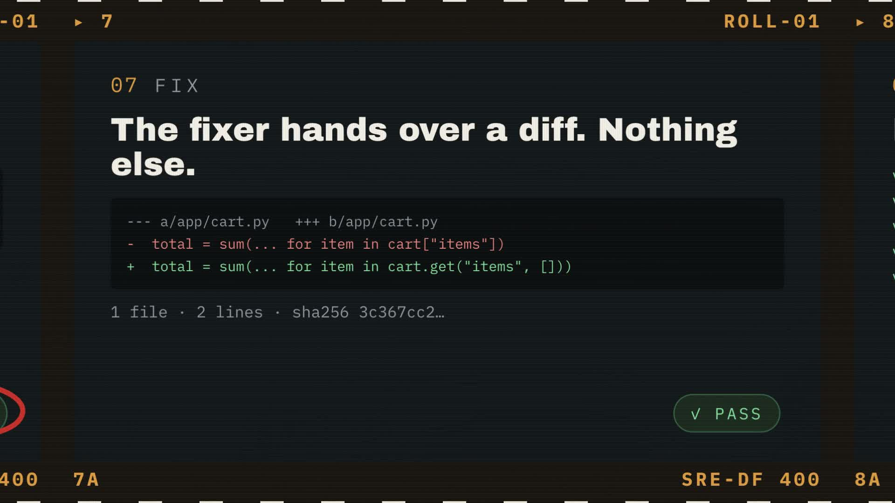
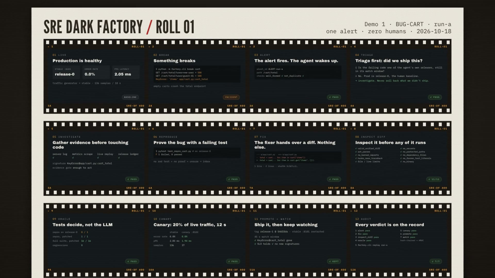

# Contact sheet: Demo 1 (BUG-CART), one minute

[](sre-contact-sheet.mp4)

**▶ [Watch the video (60 s, 1080p, MP4)](sre-contact-sheet.mp4)**

This is one incident from start to finish, shown as a darkroom proof sheet. There are 12 frames, one per stage.
The camera moves through them in order, and a grease pencil marks each verdict.
Every number comes from the real audit trail of `run-a` (`factory_flow/runs/audit.jsonl`).

| # | Stage | What the viewer sees |
|---|-------|---------------------|
| 01 | Live | stable :8101 on release-0, 0.0% errors, p95 2.05 ms |
| 02 | Break | `factory.cli break cart`: `KeyError: 'items'` in `app/cart.py:cart_total` |
| 03 | Alert | ALERT-run-a on `/cart/total`, well_formed ✓ not_duplicate ✓ |
| 04 | Triage | not one of the agent's own releases, so investigate instead of rolling back |
| 05 | Investigate | logs, metrics, replay and ledger give the signature `KeyError@app/cart.py:cart_total` |
| 06 | Reproduce | repro test fails on release-0 |
| 07 | Fix | the fixer returns a 2-line diff, and only the diff is read |
| 08 | Inspect diff | 11 static checks run before any patched code executes |
| 09 | Oracle | repro 1/1, suite 16/16, 0 regressions |
| 10 | Canary | 20% of traffic for 12 s: canary 0.0% errors, p95 1.94 ms |
| 11 | Promote + watch | release-1 @ 54d33da, 45 s watch, bug signature gone, so the release is **kept** |
| 12 | Audit | 7/7 entries pass, hash-chained + HMAC, `factory.cli replay run-a` |



## Source (HTML)

`index.html` is a [HyperFrames](https://hyperframes.heygen.com) composition: plain HTML/CSS with one GSAP timeline.
The whole sheet is laid out at full size, and a virtual camera scales and pans across it.

```bash
cd videos/sre-contact-sheet
npx hyperframes preview      # scrub / edit in the browser
npx hyperframes render       # -> renders/sre-contact-sheet.mp4
```
